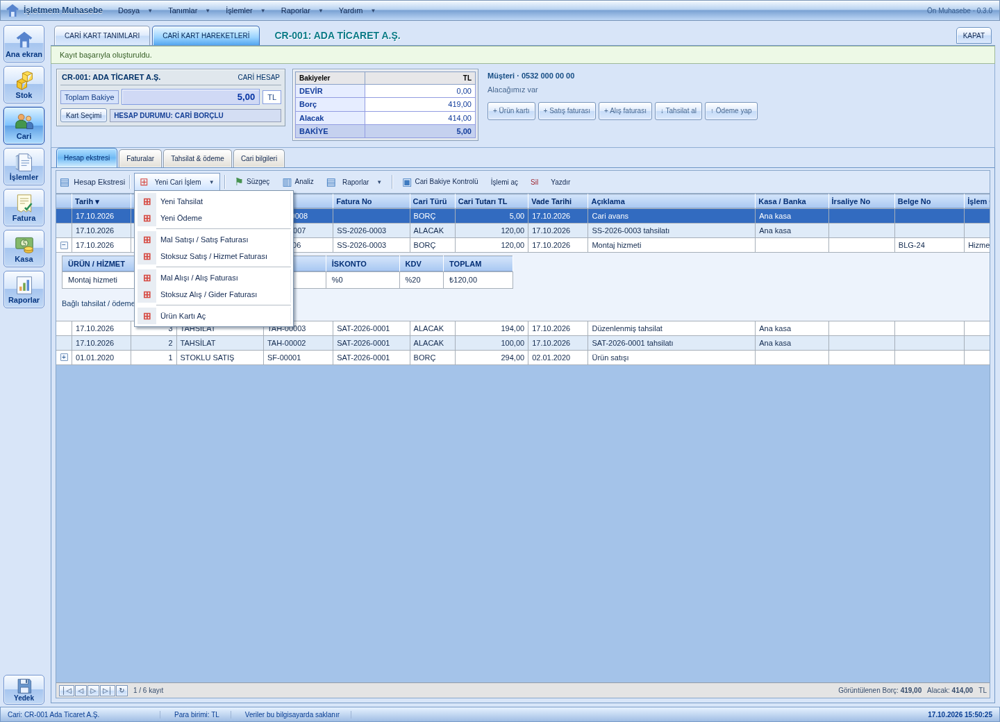
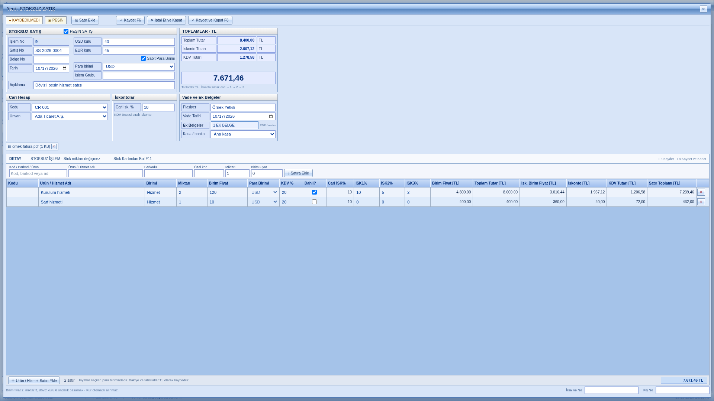

# İşletmem Muhasebe · 0.4.0

Windows x64 için Türkçe, yerel çalışan ön muhasebe uygulaması. Klasik mavi masaüstü arayüzü, modül düğmeleri, cari bakiye paneli ve satır tabanlı hesap ekstresi.

## İndirme ve güncelleme

[Son Windows kurulum paketini indirin](https://github.com/duruarven/muhasebe/releases/latest). `Isletmem-Muhasebe-Setup.exe` dosyasını çalıştırın. Paket kod imzalı değildir.

0.1.0, 0.2.0 veya 0.3.0 sürümünden güncelliyorsanız önce **Verilerimi yedekle** ile yedek alın ve uygulamayı tamamen kapatın. Aynı Windows hesabı altında güncelleyin. Uygulama kimliği ve veri konumu değişmedi. 0.1.0 verileri ilk açılışta `.v1-backup` olarak korunur ve yeni biçime geçirilir. 0.2.0 / 0.3.0 verileri aynı dosya biçiminde açılır; eski fatura toplamları yeniden hesaplanmaz. Mevcut faturalar ve kasa hareketleri aynen kalır. Eski sürüme dönmeniz gerekirse uygulama kapalıyken v1 yedeğini geri yükleyin; yeni sürümde eklediğiniz hareketler bu eski yedekte bulunmaz.

Eski toplam tutarlı faturalar cariye yansır ancak ürün satırları olmadığı için stok oluşturmaz. Önceki sürümde kasa hareketleri cariye bağlı değildi: **Tahsilat & ödeme → Düzenle** ile mevcut hareketi doğru cari ve faturaya bağlayın. Aynı tahsilatı tekrar eklemek kasa bakiyesini iki kez artırır.

## Cari üzerinden çalışma

1. **Kasa & banka → Yeni hesap**: nakit veya banka hesabınızı açın.
2. **Cari hesaplar → Yeni cari**: müşteri, tedarikçi veya her ikisi türünde kart açın. Cari kodu, vergi bilgileri, telefon, adres ve isteğe bağlı devir bakiyesi girilebilir.
3. Cari adına tıklayın. **Hesap ekstresi**, **Faturalar**, **Tahsilat & ödeme** ve **Cari bilgileri** sekmeleri açılır.
4. **Ürün kartı** ile ürün kodu, birim, KDV hariç alış/satış fiyatları, KDV oranı ve açılış stoğunu girin.
5. **Yeni Cari İşlem → Mal Satışı / Satış Faturası** veya **Mal Alışı / Alış Faturası** ile ürün seçin; miktar, birim fiyat, iskonto ve KDV girin. Birden çok satır eklenebilir. Vade tarihi ve fatura numarası kaydedilir.
6. Fatura kaydında cari bakiye ve stok birlikte güncellenir. Fatura nakit hareketi değildir.
7. **Yeni Cari İşlem → Yeni Tahsilat / Yeni Ödeme** ile kasa/banka hesabını seçin. İsterseniz ilgili faturayı seçerek kısmi veya tam ödeme girin. Fatura detayı içindeki düğme ilişkili faturayı otomatik seçer.
8. **Stoksuz Satış / Hizmet Faturası** veya **Stoksuz Alış / Gider Faturası** için ürün kartı gerekmez. Birden çok ürün/hizmet adı, birim, miktar, fiyat, iskonto ve KDV satırı girilebilir. Cari bakiye değişir, stok değişmez.
9. Hesap ekstresinde tarih, işlem no, işlem türü, fiş no, fatura no, borç/alacak yönü, TL tutarı, vade, açıklama, hesap, irsaliye, belge, grup ve işlem sonrası bakiye görünür. Geniş sütunlar için yatay kaydırın. Satırdaki **+** fatura kalemlerini açar; çift tıklama veya **İşlemi aç** detay formunu açar.
10. **Süzgeç** ile tarih aralığı, işlem türü ve metne göre süzün. Sütun başlıkları ile tarih, işlem no, tür, tutar veya vadeye göre sıralayın. Üstteki cari bakiyesi ve satır bakiyeleri tüm hareketlere göre hesaplanır; alttaki borç/alacak toplamı yalnızca görüntülenen kayıtları kapsar.
11. **Raporlar → Ekstreyi CSV / Excel kaydet** görüntülenen hareketleri Excel ile açılabilen CSV dosyasına aktarır. **Analiz** aylık satış, alış, tahsilat ve ödemeleri gösterir. **Cari Bakiye Kontrolü** ekstre/fatura toplamlarını ve bağlantıları kontrol eder.
12. Fatura detayı ve hesap ekstresi yazdırılabilir. Yazdırma ve dosya kaydetme iletişim kutuları Windows'ta açılır.

### Yeni Cari İşlem menüsü

- Yeni Tahsilat: kasa/banka girişi, isteğe bağlı fatura bağlantısı.
- Yeni Ödeme: kasa/banka çıkışı, isteğe bağlı fatura bağlantısı.
- Mal Satışı / Satış Faturası: ürün kalemleri, stok çıkışı ve cari alacağı.
- Stoksuz Satış / Hizmet Faturası: hizmet/tutar girişi ve cari alacağı.
- Mal Alışı / Alış Faturası: ürün kalemleri, stok girişi ve cari borcu.
- Stoksuz Alış / Gider Faturası: stok olmadan alış ve cari borcu.

Fiş numarası boşsa otomatik oluşturulur. Tahsilat/ödemede fiş no, belge no, irsaliye no ve işlem grubu düzenlenebilir. Ürünlü faturada irsaliye, belge ve grup bilgileri eklenebilir. Cari türü gruplama içindir; müşteri veya tedarikçi olarak sınıflandırılan aynı cariye her iki yönde de işlem girilebilir.

### Klavye

- F4: açık cari için Yeni Cari İşlem seçim penceresi.
- F2 veya satırdayken Enter: seçili işlemi aç.
- Ctrl+F: ekstre süzgeci veya liste araması.
- Ctrl+P: yazdır.
- Yukarı/Aşağı ve Home/End: hesap ekstresinde kayıt seçimi.
- Esc: açık menüyü veya pencereyi kapat.

### Hesaplama kuralları

- Pozitif cari net bakiyesi işletmenizin alacağıdır. Negatif net bakiye işletmenizin borcudur.
- Satış faturası ve cariye ödeme borç sütununa; alış faturası ve cariden tahsilat alacak sütununa yazılır.
- Açılış/devir bakiyesi kasayı etkilemez. Eski faturaları tekrar devir bakiyesine eklemeyin.
- Faturasız avanslar cari net bakiyesine girer; belirli bir faturanın kalanından otomatik düşmez. Hareketi düzenleyerek faturaya bağlayabilirsiniz.
- Kalan tutar yalnızca faturaya bağlı ödemelerden hesaplanır. Fazla veya yanlış cariye/yöne bağlı fatura ödemesi reddedilir.
- Miktar üç, fiyat ve oranlar iki, döviz kuru altı ondalık basamak destekler. Tutarlar tam sayı kuruş olarak saklanır. Her satırdaki çevrim, iskonto ve KDV kuruşa yuvarlanır; toplamlar arayüzden bağımsız olarak kayıt sırasında yeniden hesaplanır.
- Stok = açılış + alış faturası miktarları − satış faturası miktarları. Negatif stok girişine izin verilir ve kırmızı gösterilir.
- Ürün kartının fiyatı veya adı değişse de önceki fatura satırları korunur. Hareketi olan ürünün birimi değiştirilemez.
- Bağlı hareketi olan cari/hesap/ürün ve bağlı ödemesi olan fatura silinemez. Hatalı faturayı düzeltmek için önce bağlı ödemeleri kaldırın, sonra faturayı silip doğru kaydı oluşturun. Silme stok ve bakiyeleri geri alır.

## Veri ve yedek

Veriler Electron `userData` klasöründeki `muhasebe.json` dosyasındadır. Windows'ta genellikle `%APPDATA%\isletmem-muhasebe` veya `%APPDATA%\İşletmem Muhasebe` altındadır; Electron paketinin uygulama adına göre değişebilir. Dosya JSON biçimindedir ve şifreli değildir. Düzenli olarak farklı diske yedek alın.

Yedeği geri almak için uygulamayı tamamen kapatın, mevcut dosyayı ayrıca koruyun ve uyumlu yedek dosyasını aynı klasöre `muhasebe.json` adıyla kopyalayın. Uygulama açıkken veri dosyasını değiştirmeyin.

## Geliştirme ve test

Node.js 22/24 ve npm gerekir. Mevcut checkout'u kullanın; yeni worktree gerekmez.

```sh
npm ci
node node_modules/electron/install.js
npm test
npm start
```

Electron paketinin bu sürümünde ikili dosya kurulumu ayrı komutla yapılır. Grafik masaüstü ve Electron sandbox desteği gerekir. Bulut Linux ortamında pencere açılışı doğrulanmamıştır.

Arayüz testi gerçek Store ile tarayıcı köprüsü üzerinden:

```sh
npx playwright-core install chromium
npm run test:ui
```

Yüklü Chromium kullanmak için `UI_BROWSER_PATH` verilebilir. Linux bulutta `UI_BROWSER_PATH=/usr/bin/chromium npm run test:ui` kullanıldı. Gerçek Electron ana süreci ve preload/IPC ile masaüstü testi:

```sh
npm run test:desktop
```

Bu testler geçici veri klasörü kullanır; kullanıcı verilerine yazmaz. Fiziksel yazıcı test edilmez. CSV dışa aktarım testinde gerçek dosya yazımı kullanılır; dosya seçme iletişim kutusu yalnızca test sürecinde geçici bir yola yönlendirilir.

Windows kurulum dosyası:

```sh
npm run dist:win -- --publish never
```

main dalına gönderim, GitHub Actions üzerinde Windows hesaplama ve masaüstü testlerini, paketlemeyi ve Releases yayımını başlatır. Kurulum dosyası `dist/Isletmem-Muhasebe-Setup.exe` adıyla yayımlanır.

## Kapsam

Bu uygulama iç takip içindir. Resmi e-Fatura/e-Arşiv gönderimi, e-Defter, beyanname, banka entegrasyonu, iade/irsaliye yönetimi, döviz cinsinden cari bakiye, maliyet muhasebesi, çoklu kullanıcı ve ağ üzerinden veri paylaşımı içermez. KTS Pro ile bağlantılı değildir; cari merkezli bir çalışma akışı sunar.

## Klasik cari ekranı

Aşağıdaki görüntü test verileriyle alınmıştır. Açılır **Yeni Cari İşlem** menüsü, seçili cariye bağlı formları açar.




## 0.4.0 satış / alış ekranı



Görüntüdeki kayıtlar test verileridir. Stoklu ve stoksuz satış/alış aynı tam ekran belge düzenini kullanır:

- **Belge bilgileri:** işlem no (otomatik), satış/alış no, belge no, tarih, işlem grubu, açıklama ve fiş/irsaliye no.
- **Cari hesabı:** kod ve unvan alanları birbiriyle eşleşir. Karttaki varsayılan iskonto belgeye gelir ve belge özelinde değiştirilebilir.
- **Fiyat ve KDV:** TL/USD/EUR satır para birimi; KDV dahil/hariç fiyat; cari iskontosu ve sırayla uygulanan üç satır iskontosu.
- **Stok bulma:** ürün kodu, barkod, tam ad veya benzersiz özel kodla hızlı giriş. Bir özel kod birden fazla karta aitse ürün koduyla seçim gerekir. F11 arama alanına götürür. Stoksuz belgelerde serbest ürün/hizmet adı girilebilir.
- **Plasiyer, vade ve ek belgeler:** plasiyer adı serbest yazılır; tarih ve ekler belgeye saklanır. En fazla 5 PDF/PNG/JPEG, dosya başına 2 MB eklenebilir. Ekler JSON yedeğinin içinde saklanır; harici dosya yoluna bağımlı değildir. Kayıtlı belge detayından açılır.
- **Kaydet F6:** bir kez kaydeder, pencereyi inceleme için açık ve salt okunur bırakır. **Kaydet ve Kapat F8** pencereyi kapatır; F6'dan sonra tekrar kayıt oluşturmaz. Hatalı kayıtları mevcut silme/yeniden oluşturma akışıyla düzeltin.

### Peşin satış / alış

Peşin kutusunu işaretleyip kasa/banka hesabı seçin. Fatura ile bağlı tahsilat (alışta ödeme) aynı dosya değişikliği içinde kaydedilir. Herhangi bir doğrulama/kayıt hatasında iki işlem de yazılmaz. Aynı tahsilatı ayrıca girmeyin. Faturayı kaldırmak için önce bağlı peşin hareketi kaldırmak gerekir.

### Döviz ve iskonto hesabı

Kur otomatik indirilmez. İşlem için kullandığınız **1 USD/EUR karşılığı TL** değerini elle girin; sıfır veya eksik kurla dövizli kayıt yapılamaz. Kullanılan kurlar ve satır fiyatları belgede sabitlenir. Cari, kasa ve rapor bakiyeleri TL'dir; döviz cinsinden ayrı cari bakiye tutulmaz.

Sabit para birimi seçiliyse tüm satırlar üstteki para birimini kullanır. Kapatılırsa satırların para birimleri ayrı seçilebilir. Ürün kartı fiyatları TL'dir; dövizli satıra seçilen kurla çevrilir. Para birimi değişiminde geçerli kurlar varsa mevcut fiyat çevrilir; eksik kur nedeniyle çevrilemiyorsa fiyat yeniden girilmelidir. Kurun değiştirilmesi döviz fiyatını sabit tutup TL karşılığını günceller.

Önce birim fiyat TL'ye kuruş hassasiyetinde çevrilir, ardından miktarla çarpılır. İskontolar cari → 1 → 2 → 3 sırasında, her adımda kuruşa yuvarlanarak uygulanır. Oranlar toplanmaz. KDV dahil fiyatta KDV indirgenmiş toplamdan ayrıştırılır; KDV hariç fiyatta net tutara eklenir. Toplam Tutar ve İskonto Tutarı alanları KDV hariç TL değerleridir; genel toplam KDV dahildir.

Fiziksel yazıcı ve dış PDF/resim görüntüleyicisi otomatik test kapsamı dışındadır. Windows masaüstü testinde gerçek kayıt/IPC, ek belge seçimi (test dosyasına yönlendirilmiş iletişim kutusu), peşin kayıt, döviz/iskonto hesabı ve F6/F8 akışı çalıştırılır.
